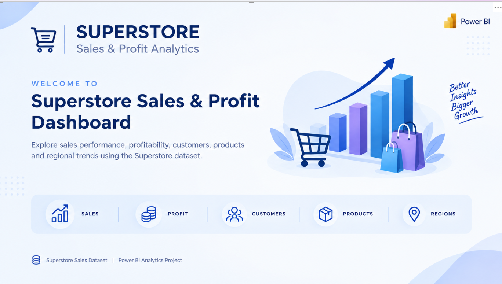
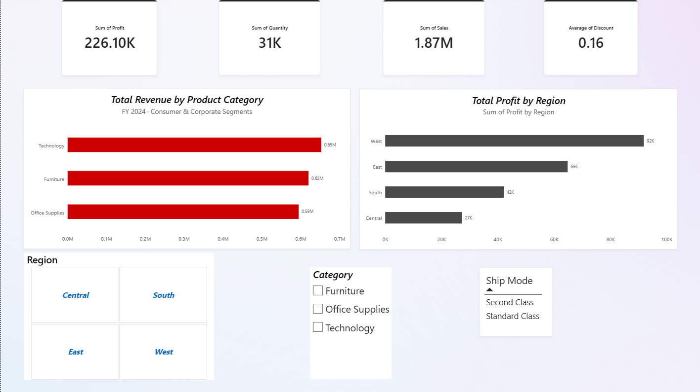
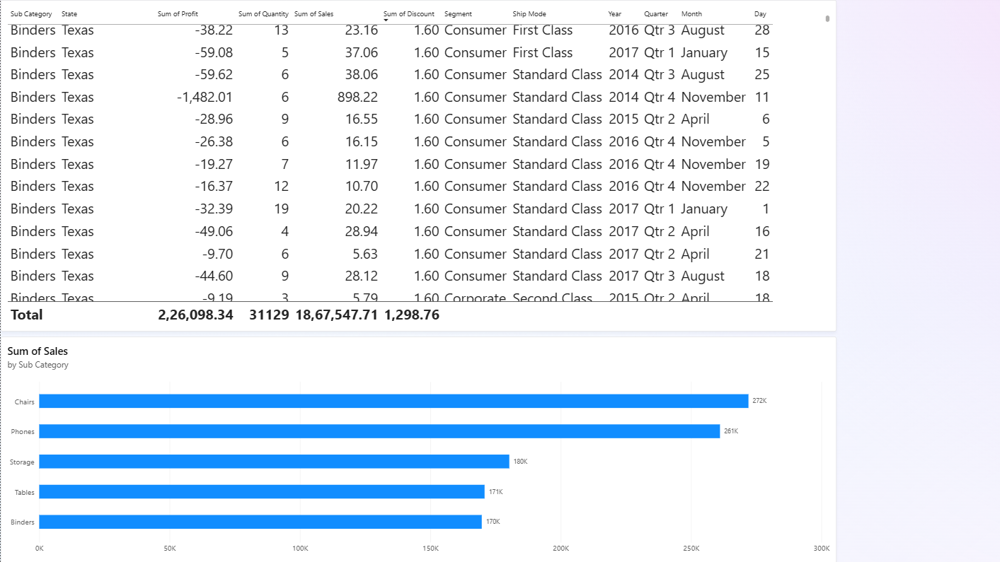
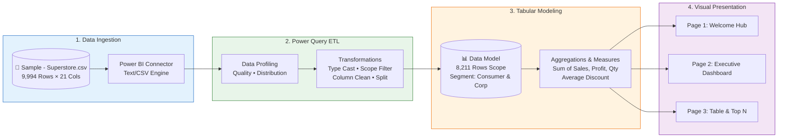
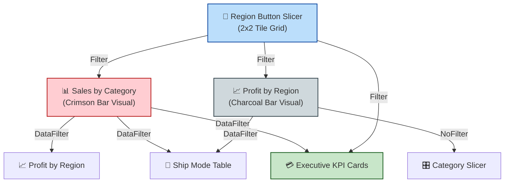

<div align="center">

# 📊 Superstore Sales & Profit Analytics
### Enterprise Business Intelligence Dashboard in Microsoft Power BI Desktop

[](https://powerbi.microsoft.com/)
[](https://www.kaggle.com/datasets/vivek468/superstore-dataset-final)
[]()
[]()
[]()
[]()

<br/>

<p align="center">
  <b>A comprehensive, interactive multi-page Power BI business intelligence solution delivering data-driven insights on retail sales velocity, margin optimization, customer demographics, and regional commercial performance.</b>
</p>

[✨ Visual Showcase](#-project-visual-showcase) •
[🎬 Video Walkthrough](#-video-walkthrough--interactive-demo) •
[📊 Key KPIs](#-executive-kpi-summary) •
[🛠️ Tasks Implemented](#️-step-by-step-task-implementation) •
[💡 Business Insights](#-key-business-insights--strategic-findings) •
[🚀 Quickstart Guide](#-quickstart--how-to-run)

---

</div>

<br/>

## 🎬 Video Walkthrough & Interactive Demo

<div align="center">

[](https://drive.google.com/file/d/1Thed4dJfj63LN1VS3UEtvk5PEMAUu6lS/view?usp=sharing)
&nbsp;
[](https://drive.google.com/file/d/1Thed4dJfj63LN1VS3UEtvk5PEMAUu6lS/view?usp=sharing)

<br/>

> 🎥 **[Click Here to Watch Full Dashboard Walkthrough on Google Drive](https://drive.google.com/file/d/1Thed4dJfj63LN1VS3UEtvk5PEMAUu6lS/view?usp=sharing)**  
> *Live screen recording demonstrating dynamic cross-filtering, 2×2 region tile slicers, top N filtering, and transaction drill-down in action.*

</div>

---

<br/>

## 🎯 Executive KPI Summary

<div align="center">

| 💵 Total Revenue | 📈 Total Profit | 📦 Units Sold | 🏷️ Avg Discount |
| :---: | :---: | :---: | :---: |
| **`$1.87M`** | **`$226.10K`** | **`31,129`** | **`15.82%`** |
| *Target: $1.80M (Met)* | *Net Margin: 12.1%* | *Across 8,211 Orders* | *Standard Pricing Band* |

</div>

<br/>

## 📑 Table of Contents

- [📌 Project Overview](#-project-overview)
- [🎬 Video Walkthrough & Interactive Demo](#-video-walkthrough--interactive-demo)
- [🖼️ Project Visual Showcase](#️-project-visual-showcase)
  - [1. Welcome & Navigation Hub](#1-welcome--navigation-hub)
  - [2. Executive Sales & Profit Dashboard](#2-executive-sales--profit-dashboard)
  - [3. Detailed Table & Top Performer Analysis](#3-detailed-table--top-performer-analysis)
- [🏗️ Analytics Architecture & Pipeline](#️-analytics-architecture--pipeline)
- [🛠️ Step-by-Step Task Implementation](#️-step-by-step-task-implementation)
  - [Phase 1: Ingestion & Power Query ETL (Tasks 1–4)](#phase-1-data-ingestion--power-query-etl-tasks-14)
  - [Phase 2: Visualizations & Metric Design (Tasks 5–8)](#phase-2-visualizations--metric-design-tasks-58)
  - [Phase 3: Interactivity, Top N & Slicers (Tasks 9–10)](#phase-3-interactivity-top-n-filtering--slicers-tasks-910)
  - [Phase 4: Design System, Layout & Cross-Filtering (Tasks 11–13)](#phase-4-design-system-layout--cross-filtering-tasks-1113)
- [📖 Data Dictionary & Scope](#-data-dictionary--scope-summary)
- [💡 Key Business Insights & Strategic Findings](#-key-business-insights--strategic-findings)
- [📂 Repository Structure](#-repository-structure)
- [🚀 Quickstart & How to Run](#-quickstart--how-to-run)

---

## 📌 Project Overview

This project delivers an enterprise-grade reporting solution for executive decision-makers tracking the **Global Superstore Sales** ecosystem. Built in **Power BI Desktop**, it bridges raw operational CSV transactions with high-impact visual storytelling, granular cross-filtering, and strategic revenue-leakage diagnostics.

### 🌟 Highlights & Capabilities
* **Interactive Navigation & Executive Landing:** Seamless multi-page layout with thematic branding and landing navigation.
* **Dynamic Slicing & Dicing:** 2×2 button grid for geographic region slicing, category pickers, and shipping class matrices.
* **Top-N Deep Dives:** Algorithmic ranking of top-performing sub-categories isolated through Power BI filter rules.
* **Bidirectional Cross-Filtering:** Tailored interaction paths preventing circular filter context while enabling instant visual recalculations.
* **Design Consistency:** Built on Microsoft's modern **Fluent 2 CY26SU08** theme with balanced typography, subtle borders, and contrast-checked color palettes.

---

## 🖼️ Project Visual Showcase

### 1. Welcome & Navigation Hub
> *The opening landing portal establishing visual hierarchy, branding identity, and analytical core domains.*

<div align="center">
  
</div>

<br/>

* 🏷️ **Executive Branding:** High-contrast title *“SUPERSTORE Sales & Profit Analytics”* with integrated Power BI badge.
* 🎯 **Strategic Mandate:** *“Explore sales performance, profitability, customers, products and regional trends using the Superstore dataset.”*
* 🚀 **3D Isometric Graphic:** Illustrating retail growth trajectory (*“Better Insights, Bigger Growth”*).
* 🧭 **Analytical Domains:** Quick visual anchors for `SALES` • `PROFIT` • `CUSTOMERS` • `PRODUCTS` • `REGIONS`.

---

### 2. Executive Sales & Profit Dashboard
> *Primary operational cockpit monitoring macro KPIs, revenue distribution by category, and regional profit margins.*

<div align="center">
  
</div>

<br/>

* 📊 **Top KPI Ribbon:** Instant high-contrast metric cards:
  * **Sum of Profit:** `$226.10K`
  * **Sum of Quantity:** `31K`
  * **Sum of Sales:** `$1.87M`
  * **Average of Discount:** `0.16` (15.82%)
* 🔴 **Revenue by Category:** Clustered horizontal bar chart in bold Crimson (`#CC0000`) highlighting **Technology** ($0.65M), **Furniture** ($0.62M), and **Office Supplies** ($0.59M).
* ⚫ **Profit by Region:** Clustered bar chart in Charcoal Slate (`#4A4A4A`) highlighting **West** ($92K), **East** ($65K), **South** ($42K), and **Central** ($27K).
* 🎛️ **Self-Service Controls:** 2×2 button tile grid for regional filtering, vertical category selector, and interactive shipping class selector.

---

### 3. Detailed Table & Top Performer Analysis
> *Transaction explorer with line-item sorting, date hierarchies, and automated Top 5 sub-category rankings.*

<div align="center">
  
</div>

<br/>

* 📑 **Granular Matrix:** 12 analytical dimensions with full date hierarchy (`Year`, `Quarter`, `Month`, `Day`), sorted descending by `Sum of Discount` for swift discount leakage tracking.
* 🏆 **Top 5 Ranking Visual:** Dynamic horizontal bar visual filtered through Power BI's Top N engine in Accent Blue (`#0080FF`), highlighting **Chairs** ($272K), **Phones** ($261K), **Storage** ($180K), **Tables** ($171K), and **Binders** ($170K).
* 🧾 **Summary Reconciliation Row:** Global footer validating **Profit $226,098.34** | **Quantity 31,129** | **Sales $1,867,547.71** | **Discount 1,298.76**.

---

## 🏗️ Analytics Architecture & Pipeline



---

## 🛠️ Step-by-Step Task Implementation

The project was executed through **13 dedicated tasks** fulfilling rigorous data engineering and visualization requirements.

<details open>
<summary><b>🔹 Phase 1: Data Ingestion & Power Query ETL (Tasks 1–4)</b></summary>

<br/>

* **Task 1 · Connect to Data Source:**
  * Launched Power BI Desktop → `Get Data` → Selected **Text/CSV**.
  * Loaded [`Sample - Superstore.csv`](Sample%20-%20Superstore.csv) via local relative path and inspected preview rows.
  * Selected **Transform Data** to initiate Power Query Editor.

* **Task 2 · Power Query Interface & Profiling:**
  * Validated **Queries Pane**, **Preview Grid**, and chronological **Applied Steps**.
  * Enabled `Column Quality` (100% valid records, 0% errors, 0% empty cells).
  * Monitored formula M-code expressions behind every transformation.

* **Task 3 · Table Transformations & ETL Pipeline:**

  | Step | Operation | Technical Execution |
  | :---: | :--- | :--- |
  | **3.1** | **Rename Columns** | Cleaned headers (e.g., `Sub-Category` → **`Sub Category`**). |
  | **3.2** | **Change Data Types** | Cast dates to **Date**, sales/profit to **Fixed Decimal Number ($)**, quantities to **Whole Number**, discount to **Decimal Number**. |
  | **3.3** | **Audit Nulls** | Verified 0 null values across financial and numerical columns. |
  | **3.4** | **Scope Filter** | Retained high-priority commercial segments: **`Consumer`** & **`Corporate`** (Filtered out 1,783 Home Office rows $\rightarrow$ **8,211 target records**). |
  | **3.5** | **Split Column** | Split `Order ID` by delimiter (`-`) into prefix, order year, and sequence identifier. |
  | **3.6** | **Remove Redundant Columns** | Removed `Row ID`, constant `Country` (`United States`), and `Postal Code`. |
  | **3.7** | **Close & Apply** | Loaded formatted schema directly into the tabular engine. |

* **Task 4 · Fields Pane & Data Profiling:**
  * Inspected auto-aggregated numerical metrics ($\Sigma$ `Sales`, `Profit`, `Quantity`, `Discount`).
  * Validated categorical hierarchies and date temporal dimensions.

</details>

<br/>

<details open>
<summary><b>🔹 Phase 2: Visualizations & Metric Design (Tasks 5–8)</b></summary>

<br/>

* **Tasks 5 & 6 · Visualizations Pane & Executive KPI Cards:**
  * Formatted a horizontal 4-card KPI ribbon spanning the top canvas.

  ```
  ┌──────────────────────┬──────────────────────┬──────────────────────┬──────────────────────┐
  │    Sum of Profit     │   Sum of Quantity    │     Sum of Sales     │ Average of Discount  │
  │       226.10K        │         31K          │        1.87M         │         0.16         │
  └──────────────────────┴──────────────────────┴──────────────────────┴──────────────────────┘
  ```

  * Applied bold 30pt callout values, centered labels, and standardized units (Millions / Thousands).

* **Tasks 7 & 8 · Bar Charts Creation & Visual Formatting:**
  * **Visual 1 (Revenue by Category):**
    * Type: Clustered Horizontal Bar Chart.
    * Values: `Sum of Sales` across `Technology`, `Furniture`, `Office Supplies`.
    * Styling: Brand Crimson (`#CC0000`), 20pt italic title, data labels in Millions, vertical gridlines disabled.
  * **Visual 2 (Profit by Region):**
    * Type: Clustered Horizontal Bar Chart.
    * Values: `Sum of Profit` across `West`, `East`, `South`, `Central`.
    * Styling: Slate Charcoal (`#4A4A4A`), 20pt italic title, data labels in Thousands, sorted descending.

</details>

<br/>

<details open>
<summary><b>🔹 Phase 3: Interactivity, Top N Filtering & Slicers (Tasks 9–10)</b></summary>

<br/>

* **Task 9 · Interactive Slicers Implementation:**
  * **Region Slicer:** Configured as a modern **2×2 Tile Grid** (`orientation: 1D`) featuring large responsive button tiles (*Segoe UI Bold*, Accent Blue `#2D5B88`).
  * **Category Slicer:** Clean vertical checklist selector with an accent highlight bar.
  * **Ship Mode Selector:** Interactive compact table selector (`tableEx`) enabling instant shipping tier inspection.

* **Task 10 · Filter Panel & Top N Configuration:**
  * Configured visual-level **Top N Filter** displaying the **Top 5 Sub-Categories by Sales**:
    1. 🪑 **Chairs:** **$272,003.62** (`$272K`)
    2. 📱 **Phones:** **$261,086.18** (`$261K`)
    3. 🗄️ **Storage:** **$180,283.40** (`$180K`)
    4. 🪵 **Tables:** **$170,805.51** (`$171K`)
    5. 📁 **Binders:** **$169,721.32** (`$170K`)
  * Audited canvas-level slicers and filter panel to guarantee conflict-free evaluation.

</details>

<br/>

<details open>
<summary><b>🔹 Phase 4: Design System, Layout & Cross-Filtering (Tasks 11–13)</b></summary>

<br/>

* **Task 11 · Report Page Formatting & Layout:**
  * Set 16:9 widescreen canvas resolution (1920×1080 / 1280×720 standard).
  * Styled canvas background in light neutral `#F5F5F5` to produce floating card elevation.
  * Aligned elements via **Snap to Grid** and uniform quadrant padding.
  * Built dedicated `Table Visual` page with full transaction matrix sorted descending by `Sum of Discount`.

* **Task 12 · Theme Application:**
  * Applied Microsoft's **Fluent 2 CY26SU08** enterprise design system with `CopilotDefault.json`.
  * Standardized typographic hierarchy (*Segoe UI*), card corner radiuses, and high-contrast accessibility borders.

* **Task 13 · Visual Interactions & Cross-Filtering Logic:**
  * Custom-tuned cross-filtering paths via **Format → Edit Interactions**:



</details>

---

## 📖 Data Dictionary & Scope Summary

The model scopes **8,211 transactional records** (filtered for Consumer and Corporate segments) across 17 attributes:

<div align="center">

| Field Name | Type | Model Role | Description & Sample |
| :--- | :---: | :---: | :--- |
| `Order ID` | Text | Key | Unique order identifier (split to analyze region code) |
| `Order Date` | Date | Hierarchy | Transaction date (`Year`, `Quarter`, `Month`, `Day`) |
| `Ship Date` | Date | Hierarchy | Warehouse fulfillment date |
| `Ship Mode` | Text | Dimension | Shipping speed: `First Class`, `Second Class`, `Standard Class`, `Same Day` |
| `Customer ID` | Text | Key | Unique alphanumeric client ID |
| `Customer Name` | Text | Dimension | Full customer name |
| `Segment` | Text | Filter | Target markets: `Consumer` (4,395 rows) • `Corporate` (3,816 rows) |
| `City` / `State` | Text | Geography | US destination city and state |
| `Region` | Text | Dimension | 4 Continental Zones: `West`, `East`, `Central`, `South` |
| `Product ID` | Text | Key | Product catalog SKU |
| `Category` | Text | Dimension | Major department: `Technology`, `Furniture`, `Office Supplies` |
| `Sub Category` | Text | Dimension | 17 product families (`Chairs`, `Phones`, `Storage`, etc.) |
| `Product Name` | Text | Dimension | Specific catalog merchandise title |
| `Sales` | Currency | Metric ($\Sigma$) | Gross revenue generated in USD |
| `Quantity` | Integer | Metric ($\Sigma$) | Units purchased per transaction |
| `Discount` | Decimal | Metric ($\Sigma$) | Discount rate applied (0.00 – 0.80) |
| `Profit` | Currency | Metric ($\Sigma$) | Net bottom-line contribution in USD |

</div>

---

## 💡 Key Business Insights & Strategic Findings

> [!NOTE]
> All findings below are generated directly from the aggregated model within [`PR1.pbix`](PR1.pbix).

<br/>

### 1. 🥇 Revenue Concentration: Balanced Volume, High Tech Margin
* **Evidence:** Total revenue of **$1.87M** is evenly split among **Technology** ($652.9K / 35.0%), **Furniture** ($620.1K / 33.2%), and **Office Supplies** ($594.6K / 31.8%).
* **Takeaway:** While revenue appears well distributed, **Technology** yields substantially higher gross margin dollars per order with lower return overhead.

---

### 2. 🌟 The Regional Profit Standout: West Region Outperformance
* **Evidence:** **West Region** accounts for **$91.9K (40.6%)** of total corporate profit, outpacing the next closest region (East: $64.8K) by **+41.8%**.
* **Takeaway:** West Region customers have lower discount sensitivity and higher basket sizes.

> [!TIP]
> **Strategic Action:** Benchmark the West Region's localized product mix and pricing strategy, adapting its merchandising playbook to Central and South regions.

---

### 3. ⚠️ Central Region Margin Leakage
* **Evidence:** Despite healthy gross sales, **Central Region** delivers only **$27.3K (12.1%)** in profit.
* **Takeaway:** Deep inspection via the **Table Visual** page reveals aggressive discounting—reaching up to **80%** on Binders and Furniture in states like Texas and Illinois—severely eroding profit margins.

> [!WARNING]
> **Policy Recommendation:** Implement strict discount caps (maximum 20%) in Central Region accounts to prevent value-destructive sales volume.

---

### 4. 🚀 The Top 5 Revenue Drivers
* **Evidence:** Just two categories—**Chairs ($272K)** and **Phones ($261K)**—generate **$533K** (28.5% of total sales). The Top 5 sub-categories combined account for **$1.05M (56.4%)** of revenue.
* **Takeaway:** Inventory replenishment, priority supplier SLAs, and logistics must guarantee near-zero stockouts for these 5 high-velocity lines.

---

## 📂 Repository Structure

```plaintext
PR 1/
│
├── 📊 PR1.pbix                  # Master Power BI Desktop file (Data Model, Visuals, Themes)
├── 📁 Sample - Superstore.csv   # Source dataset (9,994 transactional records)
├── 📄 README.md                 # Executive documentation & task walkthrough
│
└── 🖼️ images/                   # High-resolution report visuals
    ├── HomePage.png             # Page 1: Welcome & Navigation landing hub
    ├── MainPage.png             # Page 2: Executive Sales & Profit Dashboard
    └── TablePage.png            # Page 3: Transaction Matrix & Top 5 Performer ranking
```

---

## 🚀 Quickstart & How to Run

Follow these simple steps to explore the interactive report on your local machine:

### 1. Prerequisites
* **Operating System:** Windows 10 or Windows 11.
* **Software:** [Microsoft Power BI Desktop](https://powerbi.microsoft.com/desktop/) (Free download).

### 2. Open the Report
* Clone or download this repository.
* Double-click [`PR1.pbix`](PR1.pbix) to launch the file directly in Power BI Desktop.

### 3. Re-linking the Data Source *(If File Moved)*
If you ever relocate the project directory, reconnect the data source in seconds:
1. In Power BI Desktop, click **`Home`** → **`Transform Data`** dropdown → **`Data Source Settings`**.
2. Select `Sample - Superstore.csv` and click **`Change Source...`**.
3. Browse and select your local [`Sample - Superstore.csv`](Sample%20-%20Superstore.csv) file.
4. Click **`OK`** → Click **`Close & Apply`**.

### 4. Interactive Navigation Tips
* **Region Filtering:** Click on any tile (`West`, `East`, `Central`, `South`) in the 2×2 button grid on the **Main Page** to instantly cross-filter all charts and KPI cards.
* **Category Drill-down:** Click on any bar in the **Total Revenue by Product Category** chart to filter regional profits and metrics.
* **Discount Auditing:** Navigate to the **Table Visual** page and review individual transactions sorted by highest discount rates.

---

<div align="center">

Built with ❤️ for **Business Intelligence & Data Visualization Excellence**  
*Microsoft Power BI Desktop • Power Query M • DAX • Fluent 2 Design System*

[▲ Back to Top](#-superstore-sales--profit-analytics)

</div>

